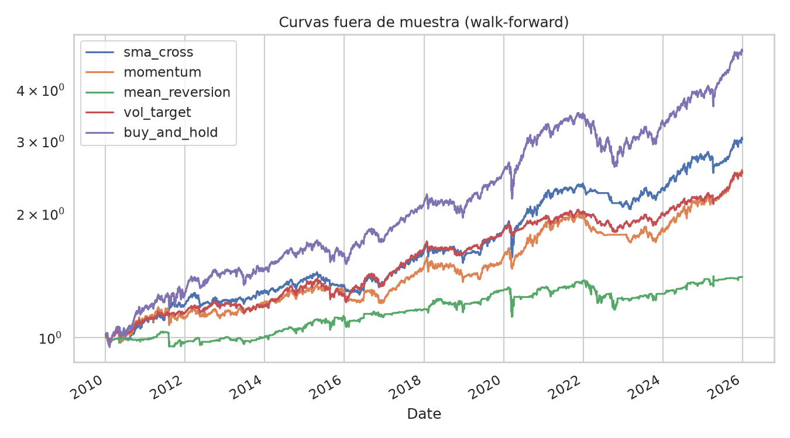
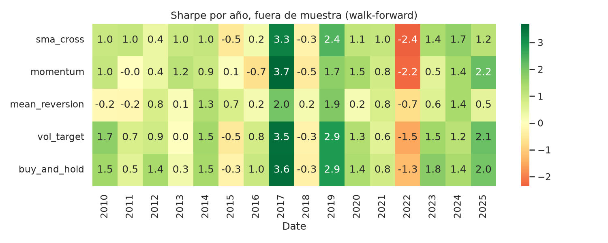
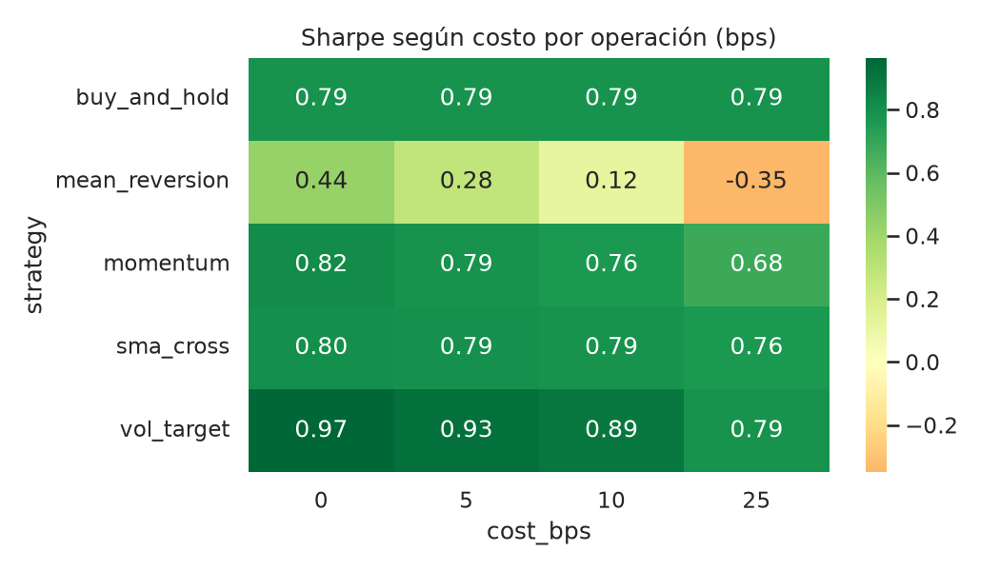
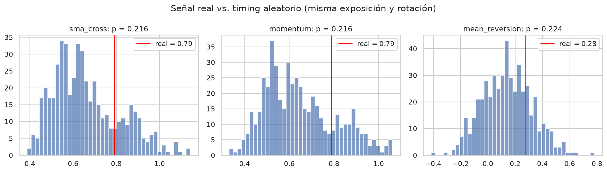
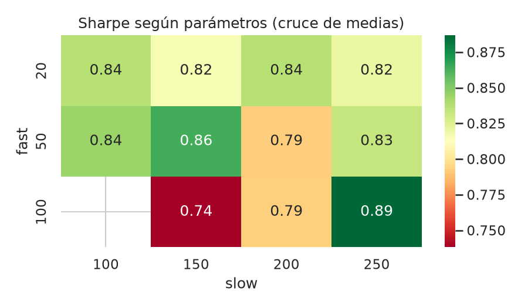

# Quant Backtest: Do Simple Trading Rules Survive Costs and Out-of-Sample Tests?


Vectorized backtesting framework and research study on five liquid ETFs (SPY, QQQ, TLT, GLD, EEM, 2005-2025). It compares trend, momentum, mean-reversion and volatility-targeting rules against buy & hold using realistic costs, walk-forward validation and multiple-testing correction.

## Key findings (walk-forward, out-of-sample 2010-2025, net of 5 bps costs)

| Strategy | Sharpe (95% CI) | Diff. vs buy & hold (95% CI) | Max drawdown | Net CAGR | Deflated Sharpe |
|---|---|---|---|---|---|
| Buy & hold (equal weight) | 0.92 | — | -26% | 10.6% | n/a |
| Volatility targeting | 0.95 [0.47, 1.46] | +0.02 [-0.20, +0.23] | -12% | 5.9% | 0.92 |
| SMA cross | 0.82 [0.37, 1.33] | -0.10 [-0.38, +0.20] | -18% | 7.2% | 0.82 |
| Momentum 12-1 | 0.73 [0.28, 1.21] | -0.19 [-0.50, +0.11] | -15% | 6.0% | 0.71 |
| Mean reversion | 0.32 [-0.06, 0.79] | -0.60 [-0.95, -0.22] | -15% | 2.1% | 0.14 |

**In one paragraph:** no strategy beats buy & hold on a risk-adjusted basis once costs, out-of-sample testing and multiple testing are accounted for. Volatility targeting matches buy & hold (Sharpe 0.95 vs 0.92), but the difference is statistically indistinguishable from zero and its Deflated Sharpe (0.92) stays below the 0.95 threshold. SMA cross and momentum are slightly worse and not distinguishable from the benchmark; mean reversion is significantly worse and highly sensitive to costs. A random-timing placebo with the same exposure and turnover matches or beats the real signals about 20% of the time (p ≈ 0.18-0.25), so most of their Sharpe comes from being invested, not from timing. Optimizing parameters on past data did not help: walk-forward results were equal to or worse than fixed textbook parameters. **What does survive is risk reduction:** the timing rules roughly halve the maximum drawdown, at the cost of lower returns.

## Method

- **No look-ahead:** signals use the close of day *t* and trade at the close of *t+1* (they earn returns from *t+2*). Unit tests verify it, including one showing that altering future prices does not change past walk-forward results.
- **Costs:** 5 bps per unit of capital traded, with sensitivity from 0 to 25 bps and execution delays of 0-2 days.
- **Walk-forward:** 5-year train / 1-year test, rolling; parameters chosen on in-sample Sharpe only; 16 out-of-sample years (2010-2025).
- **Multiple testing:** 32 parameter combinations tried (logged in [`EXPERIMENTS.md`](EXPERIMENTS.md)); Deflated Sharpe Ratio reported.
- **Uncertainty:** 20-day block-bootstrap confidence intervals (2,000 resamples) for the Sharpe ratio and for the paired difference vs. buy & hold, plus a random-timing placebo test.
- **Strategies:** buy & hold, SMA cross (50/200), momentum 12-1 (252/21), mean reversion (20-day z < -1), volatility targeting (10% annual, 21-day window). Long-only, no leverage, 1/5 of capital per ETF.

## Figures







## Extensions

- **Monthly rebalancing:** deciding only at month-end cuts annual turnover sharply (mean reversion 26.9x → 3.9x, momentum 5.4x → 1.3x, volatility targeting 4.6x → 1.8x; SMA cross barely trades either way) with similar or better Sharpe (volatility targeting 0.93 → 0.96, momentum 0.79 → 0.77; mean reversion 0.28 → 0.58 and far less cost-sensitive). These 4 variants were tested in-sample after seeing the daily results, so they raise the trial count to 36.
- **Mexican investor view (prices in MXN):** USD/MXN rose from 10.55 to 17.97 (2006-2025) and is negatively correlated with equities (-0.38 with SPY), so the dollar acts as a natural hedge: buy & hold earns 13.2% a year in pesos vs. 10.2% in dollars, with a smaller drawdown. The 0% cash assumption is especially unrealistic in pesos (Cetes yielded roughly 3-11%).
- **Interactive dashboard:** `app/dashboard.py` (Streamlit) lets you change the strategy, transaction cost and execution delay.

## Limitations

- Universe chosen with hindsight (ETFs that exist today): survivorship/selection bias.
- Cash earns 0%; no taxes, no market impact; daily rebalancing to target weights ignores weight drift (so buy & hold pays no costs).
- Costs are assumed, not measured. Yahoo Finance adjusted prices can change slightly between downloads.
- 16-20 years is a short sample for Sharpe estimation (standard error around 0.22-0.25).
- Changing parameters between walk-forward windows is not charged a transition cost.

## How to reproduce

```bash
git clone https://github.com/luis19vallejo02/quant-backtest.git
cd quant-backtest && python -m venv .venv && source .venv/bin/activate
pip install -r requirements.txt
python -m src.run      # downloads prices via yfinance and writes reports/metrics.json
pytest -q              # 16 tests, no data or network needed
```

Notebooks (run in order): `01_eda_returns` (data quality and stylized facts), `02_strategies` (strategies, backtest engine, metrics), `03_validation` (walk-forward), `04_robustness` (bootstrap, Deflated Sharpe, placebo), `05_extensions` (monthly, MXN, dashboard). All parameters live in [`config.yaml`](config.yaml).

Dashboard: `pip install streamlit && streamlit run app/dashboard.py`.

## Project structure

```text
src/data.py        price and FX download with local cache
src/signals.py     strategies (signals) and the monthly wrapper
src/backtest.py    vectorized engine with costs and execution delay
src/metrics.py     CAGR, volatility, Sharpe, Sortino, drawdown, Calmar
src/validation.py  walk-forward, block bootstrap, PSR/DSR, timing placebo
src/run.py         end-to-end pipeline -> reports/metrics.json
tests/             pytest suite (look-ahead, delay, costs, walk-forward, monthly)
```

## Data

Daily adjusted prices (dividends and splits, `auto_adjust=True`) from Yahoo Finance via yfinance, 2005-01-03 to 2025-12-30, downloaded on 2026-11-25 (cache fingerprint `sha256[:12] = 49ae3c57684c`, stored in `reports/metrics.json`). Data is not redistributed: it is downloaded on first run for personal/educational use.

## Disclaimer

Educational research project. Not investment advice.
